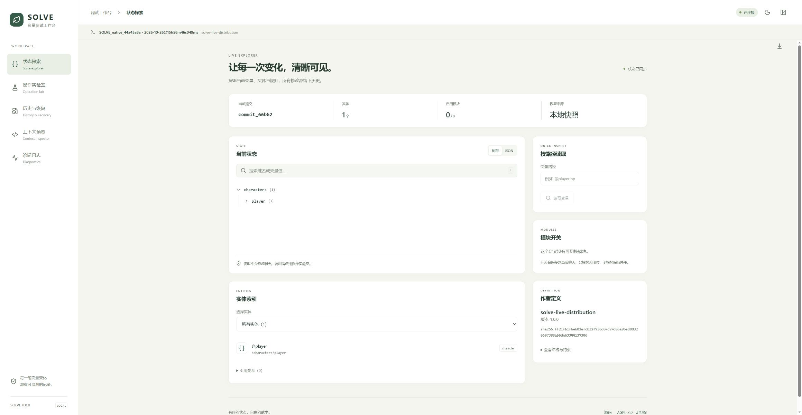
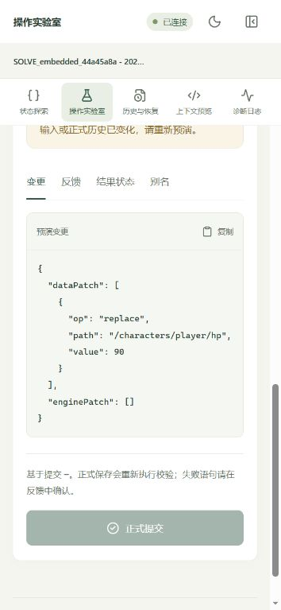

# SOLVE 引擎与调试面板验证记录

## 0.8.4-preview.1 边界验收与本地交付

日期：2026-10-27（Asia/Shanghai）。执行计划见 [acceptance-release-plan.md](acceptance-release-plan.md)。JSON Patch 和格式 3 保持不变；当前只交付预览版，没有宣称完整真实页面验收或远程发布完成。

修复两处具体问题：

1. SillyTavern 1.19 删除 Swipe 时先移除 swipes/swipe_info 并发出对象负载，再切换显示正文。旧实现把它当一般删除处理，可能使用旧正文、旧原生下标及错位变量。现在按存活提交身份重新对齐，宿主支持排序时在已注册的助手变量处理之后执行。
2. 一个客户端提交后，另一个客户端的旧页面若只加载新归档、仍沿用旧正文/选中修订，重新保存可能形成不一致。打包前增加选中修订一致性和候选正文摘要检查，拒绝旧页面覆盖；重新检查失败后控制器转为未就绪，提示在酒馆重新加载聊天。

### 自动检查

`node scripts/check-portable.mjs`：类型、**120 项测试**、三载体构建和构建包检查通过。结果为 `test-results/preview-check.log`。新增 `tests/acceptance.test.ts` 的 7 项回归：当前/非当前 Swipe × 有/无助手变量处理的四种组合、结束与渲染间停止及重新生成、取消后的迟到响应、两客户端过期页面保护。

### 真实酒馆接口

`scripts/test-live-boundaries.ts` 连接 11451，核实 SillyTavern 1.19.0；报告为 `test-results/acceptance-latest.json`，完整目录记录在 directory 字段中。12 个检查通过：

| 场景 | 实际结果 |
| --- | --- |
| 停止、重新生成、重复结束 | 停止不提交，重新生成 HP=85，重复结束不重复执行 |
| 编辑上游并重放 | 当前 HP=65，原修订仍可恢复 HP=85 |
| 删除中间楼并重放／删除末楼 | 分别恢复为 HP=90、100 |
| 删除当前／非当前 Swipe | 分别恢复 HP=85、70，下标和楼层变量一致 |
| 独立分支 | 分支 HP=86，原聊天保持 85 |
| 保存前失败、保存后响应丢失 | 原候选重试，最终 HP=84，无重复扣血 |
| 两独立控制器客户端 | 旧页面拒绝覆盖，重载后正常提交到 HP=97 |
| 可控独立操作模型 | 超时后迟到响应无效，下一次请求正常到 HP=90 |
| 三种卡片 PNG 导出／导入 | PNG 签名、助手脚本数据和开场白均保持一致 |

事件在 Node 中按 1.19 源码时序重现，保存和回读走真实酒馆；没有调用真实模型服务。PNG 验证传输与脚本载荷，不代表导入后的页面脚本已经点击运行。每次仅创建 UUID 命名的临时角色及其聊天，结束自动删除；报告 cleanup=true。

### 发布检查与剩余边界

本地包在 `artifacts/releases/0.8.4-preview.1/`，含原生、动态、内嵌、对应源码和 SHA256 清单。`npm run test:release` 核对版本、入口、ZIP CRC、SHA256、确定性、每包同一源码及无本机 HUD/身份泄漏，并实际执行包内助手入门脚本验证初始 HP=100。离线缓存安装已在独立源码解包目录完成；干净源码的检查结果保存在 `test-results/clean-source-check.log`。构建统一调试映射中的源码换行符，排除 CRLF/LF 对归档字节的影响；两目录逐包哈希对比记录在 `test-results/clean-source-release.json`。

已加入 Linux/Windows 的 GitHub 检查配置。GitHub 插件仍报告 push=false；用户随后更新文件权限，主仓库 .git 已允许正常写入。Git HTTPS 改用正常校验证书的 OpenSSL 后，远程读取与空变更试推送成功。远程提交、检查和发布状态分别以 GitHub 的提交、Actions 和 Releases 记录为准，本地成功不代替远程结果。

真实页面 H01～H10 的剩余部分、真实多标签页、真实独立连接预设和此前预设恢复仍待完成。Edge 操作和 DSH 审查启动被工具审批拒绝，原因是本会话不允许审批；没有用其他自动化入口绕过，也没有将其记为通过。历史测试角色和独立测试扩展保留；本轮临时测试角色已清理。

## 0.8.3 第二轮存储瘦身

日期：2026-10-26（Asia/Shanghai）。采用格式 3，UUID/SHA256 完整短编码、校验表共享、短回复指针、默认动作标签省略、重复历史 Patch 共享和聊天快照精简。未截断校验值，未裁剪旧历史，操作与 dataPatch 继续使用 JSON。

类型检查、**113 项测试**、三载体构建与构建包检查通过，输出为 `test-results/compact-v3-check.log`。新增 5 项回归检查短编码的全部位与自定义前缀、四种校验及索引损坏、格式 2 迁移及模块/作者输入、短指针冷读取与新 Swipe 继承变量、精简快照与短提交检查/对比、原生保存不重新扩张指针。之前的删楼、重放、保存失败及跨刷新草稿检查继续通过。

真实本机 API 转换与回读结果为 `test-results/live-distribution/compact-v3-report.json`，转换前备份路径保存在 backup 字段。三个聊天保留原来的 5、6、5 个提交，逐个恢复全部旧修订，完整 Archive 哈希与正文均未改变，数值仍是 91/70、90/70、96/70。楼层载荷比 0.8.2 分别减少 58.28%、57.67%、57.19%；计入聊天头和快照后，总 SOLVE 载荷减少 46.59%、46.04%、47.00%。具体字节见 [storage-format.md](storage-format.md)。

独立分支 `SOLVE_compact_44a45a8a_26e9d127` 的 Swipe、预演不落盘、正式扣血 95→94、同 actionId 去重和冷恢复通过。另通过实际保存 API 写入控制器当前内存对象的原生式 JSON 载荷，回读确认指针仍只有 ref/index，归档哈希不变，结果为 `test-results/live-distribution/compact-v3-native-save-report.json`。

本机原生测试扩展与内嵌测试脚本更新到 0.8.3，动态入口提供同版运行时。本轮验证代码、真实 API 和存储；未代称已刷新浏览器页面或点击变量面板。

## 0.8.2 第一轮存储瘦身

日期：2026-10-26（Asia/Shanghai）。统一正式楼层变量存储，去掉 extra/Swipe 整包重复归档，共享公共上下文和历史操作/反馈前缀，省略空可选字段，新提交不归档临时生成令牌。没有裁剪旧历史，也没有将 JSON 压缩成不可读字符串。

类型检查、**108 项测试**、三载体构建及构建包检查通过，输出为 `test-results/compact-check.log`。新增 `tests/storage.test.ts` 检查单份修订、完整历史无损恢复、共享上下文/祖先、临时令牌不落盘，以及正式记录被改坏或丢失时明确失败。原有保存重试、切 Swipe、分支、删楼和重放检查继续通过。

`scripts/test-live-compaction.ts` 在本机 11451 端口读取三份已有测试聊天，先备份，再通过实际保存 API 转换并回读。逐项核对展开后的整个 Archive 哈希不变、每个旧修订恢复状态不变、正文不变、活跃快照不变；三个聊天分别保留 5、6、5 个提交，HP/金币仍为 91/70、90/70、96/70。楼层载荷分别减少 **72.07%、72.24%、70.89%**，计入聊天头和快照后 SOLVE 总载荷减少 **61.42%、63.85%、60.75%**。完整字节对照见 [storage-format.md](storage-format.md)。

新建独立分支 `SOLVE_compact_44a45a8a_d46fbe29`，实际控制器切到另一 Swipe 得到 95 HP；预演不写盘，正式提交后为 94 HP，相同 actionId 重试不再次扣血，重新创建控制器冷恢复和归档检查通过。

结构化结果：`test-results/live-distribution/compact-report.json`；转换前文件保存在报告 backup 指定的目录。本机原生测试扩展和内嵌测试脚本更新到 0.8.2，动态文件服务提供同版运行时。浏览器访问限制仍在，本轮不冒称已代用户刷新页面或点击变量面板；刷新后加载新引擎才能看到新布局。

## 0.8.1 酒馆助手变量修复

日期：2026-10-26（Asia/Shanghai）。修复楼层变量缺少操作、diff、commit，以及聊天变量缺少活跃数据快照的问题。原不可变归档保留；增加 `derived: true` 的标准变量读取副本，具体字段见 [debug-api.md](debug-api.md#酒馆助手标准变量)。

类型检查、**104 项测试**、三载体构建及构建包检查通过，完整输出为 `test-results/variables-final-check.log`。新增 `tests/variables.test.ts` 的 8 项回归覆盖标准存储路径、旧聊天自动补齐、每个 Swipe 的独立记录与切换保存、候选保存失败和原结果重试、变量回读丢失、篡改副本修复、聊天隔离、预演不落盘、刷新和删楼恢复。

使用 `scripts/test-live-variables.ts` 连接真实 `http://localhost:11451` 的 SillyTavern 1.19.0。只操作此前创建的三个 UUID 验收角色和额外测试分支，通过实际保存接口回读标准字段：

| 聊天 | 补齐后的 HP/金币 | 结果 |
| --- | --- | --- |
| `SOLVE_dynamic_44a45a8a` | 91/70 | 3 个楼层/Swipe 变量记录，原归档哈希不变 |
| `SOLVE_embedded_44a45a8a` | 90/70 | 3 个楼层/Swipe 变量记录，原归档哈希不变 |
| `SOLVE_native_44a45a8a` | 96/70 | 3 个楼层/Swipe 变量记录，原归档哈希不变 |

每份聊天重新创建控制器并冷恢复后，聊天快照与恢复状态一致。额外分支 `SOLVE_variables_44a45a8a_a5716a3e` 切换到另一 Swipe 后保存 95/100，预演不改变磁盘快照，正式提交后保存 94/100。每份变量的操作、双 Patch 与 commit 都逐项核对，状态哈希与当前提交一致，没有重跑原模型指令。

结构化报告：`test-results/live-distribution/variables-report.json`。本机原生测试扩展和内嵌测试卡脚本已更新到 0.8.1，动态文件服务提供相同版本的 runtime。本轮验证了真实 API、控制器、存储及回读；Edge 访问权限仍未恢复，未冒称已刷新页面或点击酒馆助手变量面板。用户刷新酒馆页面后才能加载新的运行时代码。

## 0.8.0 三载体实机验收

日期：2026-10-26（Asia/Shanghai）。目标为用户本机 `http://localhost:11451`，实际版本 **SillyTavern 1.19.0**，酒馆助手 **4.11.3**，使用 Edge 操作真实页面。0.8.0 是本地开发版，本轮未提交、推送或发布新版本。

| 分发方式 | 实际隔离方式 | 已验证结果 |
| --- | --- | --- |
| 动态 Import | 原生 SOLVE 扩展尚未安装，酒馆助手导入本机 HTTP 文件服务 | 初始化、真实流式 LLM 回复、自动保存、去重、原子操作、失败回退、回读、刷新恢复通过 |
| 卡内单文件 | 原生 SOLVE 扩展尚未安装；SOLVE 文件服务返回 503 后冷启动 | 引擎与完整面板可独立启动；真实回复、操作、回读、断服刷新恢复通过 |
| 原生扩展 | 通过酒馆安装接口安装独立测试扩展；测试角色不含 SOLVE 助手脚本，providers 为空 | 真实回复、自动保存、操作、回读、刷新恢复通过；新 Swipe 生成和切回旧 Swipe 恢复通过 |

使用三个独立角色 `SOLVE_dynamic_44a45a8a`、`SOLVE_embedded_44a45a8a`、`SOLVE_native_44a45a8a`，没有替换用户原有角色或聊天。测试开始时的初始状态都是 HP=100、金币=100。

### 实际数值和归档

- 动态版：两次模型动作分别扣 5 HP；原子用户操作扣 30 金币并加 1 HP，重复同一 actionId 不再执行；余额不足的 group 完整回退。最终 HP=91、金币=70。
- 内嵌版独立运行：一次模型动作后 HP=95；原子用户操作后 HP=96、金币=70。关闭 SOLVE 文件服务并刷新，仍恢复相同提交。
- 原生版：一次模型动作与同类用户操作后 HP=96、金币=70。新 Swipe 从父状态开始得到 HP=95、金币=100；切回原 Swipe 恢复 HP=96、金币=70，调试面板自动刷新。
- 内嵌脚本与原生扩展共存：页面显示 native=true 且只有一个 embedded 脚本提供者。真实回复只把 HP 从 96 扣到 91；重复处理没有再次扣血。手机调试面板预演 -1 HP 时，正式状态保持 91；点击正式提交后保存为 90。
- 重新通过本机 API 读取三份聊天文件，仅凭 JSON 归档恢复并核对 stateHash，全部一致。最终状态：动态 91/70、内嵌 90/70、原生 96/70（HP/金币）。归档中共 6 个不同模型动作，包括新 Swipe；累计修订数不等于请求次数。

结构化结果：`test-results/live-distribution/disk-report.json`。浏览器过程记录包括 `dynamic-result.json`、`embedded-actions.json`、`embedded-reload.json`、`native-actions.json`、`native-swipe-new.json`、`native-swipe-restored.json`、`coexist-before.json`、`coexist-after.json`。截图位于同一目录。

已人工查看并保留的有效截图：

动态版和内嵌版的两张早期截图捕获在绘制前，为空白图，不作为视觉证据；相应功能依据实际界面读取、操作结果和聊天回读记录验证。

### 实机发现并修复

1. 动态文件服务跨端口时，直接打开远程面板无法访问酒馆父页面；改为获取自包含面板 HTML 并通过同源 srcdoc 打开。
2. 内联构建时替换字符串中的特殊字符可能提前截断脚本；改用替换回调，增加单文件脚本及 HTML 语法验证。
3. 1.19 流式生成会先发出 GENERATION_ENDED，再完成渲染和最终保存，导致 SOLVE 保存与宿主保存竞争；现在等待渲染并加入宿主保存队列后再处理变量。
4. 新 Swipe 暂时继承旧正文和 extra，旧 headId 会使新请求被误拦截；新身份现在清除继承的选中指针。
5. Swipe 恢复后没有通知观察者，面板可能显示旧状态；增加恢复通知并覆盖自动刷新回归。
6. 补齐共享运行时、脚本注册所有权、同版本卡脚本优先与停用清理，避免多个载体重复执行。

### 自动检查与手机界面

类型检查、**96 项测试**、三载体构建及构建包检查全部通过。最后使用 `node scripts/check-portable.mjs` 完成整套检查，输出保存在 `test-results/live-distribution/check-portable.txt`。常规 tsx 启动器在当前 Windows 工具环境中读取用户信息时报 `uv_os_get_passwd ENOMEM`；替代入口编译相同测试后使用 Node 的测试运行器运行，没有删减断言或跳过测试。

在 390×844 浏览器视口中，真实宿主内面板的 document clientWidth/scrollWidth 都为 354，main clientWidth/scrollWidth 都为 341，没有横向溢出。路径读取返回 91；预演显示将 HP 改为 90，但尚未保存；正式提交后页面提示“操作已正式保存到聊天”，磁盘恢复也得到 90。测试结束前已重置视口覆盖。

### 待收尾与验证边界

最后发出了切换到动态测试角色的指令，随后浏览器工具的自动检查因额度失败而没有执行下一步；工具切换后，Windows 电脑操作工具又明确拒绝访问 Microsoft Edge。因此，**最后一次动态/原生切换的页面复核和恢复原预设尚未完成**。测试前的预设名称是 `kami-v0.92-100-20261021`，测试专用预设为 `SOLVE_实机验收_44a45a8a`。有浏览器访问权限后需恢复；手动也可在酒馆输入 `/preset kami-v0.92-100-20261021`。三个验收角色、聊天、专用预设和测试扩展保留，便于复核。

本轮没有完整验收所有停止/删除/分支/独立操作模型入口、PNG 导出再导入、多标签并发、不同引擎版本共存，以及第三方直接联网请求；这些不能由三种分发的主流程通过推定为全部通过。脚本传输检查的覆盖范围见 [distributions.md](distributions.md)。最后一轮 DSH 定向复核因 SERVER 失败，没有计为审查通过；主代理已核对当前改动并完成上述实机和自动验证。后来自动回传的其他审查属于更早版本，不能当作当前未修复问题清单。

## 0.7.1 历史验证记录

日期：2026-10-26（Asia/Shanghai）。项目版本：0.7.1。此记录描述实际验证，企划中的其余目标不据此视为已完成。0.7.1 的变更为 AGPL-3.0-only 许可、源码入口及分发说明；原 0.7.0 的功能验证记录保留。

## 自动验证

`npm run check`：类型检查、**90 项自动测试**、浏览器构建，以及构建包在独立 JavaScript 上下文中的运行检查，全部通过。准确结果以最新命令输出为准。

自动测试覆盖核心算子/group、事务回退、异步和跨字段校验、实体/引用/模块、默认值/变换、投影/宏、历史分支、动作去重、保存失败草稿、控制器并发和迟到请求。准确数量以最新测试输出为准。

测试文件：`tests/core.test.ts`、`tests/history.test.ts`、`tests/host.test.ts`、`tests/controller.test.ts`、`tests/regression.test.ts`、`tests/debug.test.ts`、`tests/debug-ui.test.ts`。新增检查涵盖编辑器输入类型、输入/作者输入/历史变化使提交基线失效，以及真实控制器演示中的预演不落盘、旧修订不切换、保存失败重试与归档校验。

## 调试面板浏览器验证

通过 CUA 在 Edge 实际操作本机 `127.0.0.1:4175` 的独立演示与同源嵌入测试页。演示使用真实引擎/控制器与内存宿主，不调用模型、不修改真实聊天。

- 状态树、实体索引和路径读取可用。
- 预演显示 hp 变化，编辑后正式提交被禁用；重新预演并提交成功。
- 模拟保存失败会保留草稿并阻止新写入；关闭故障后重试成功，hp 从 85 经两次 -6 到 73，未重复执行。
- 历史列表保留三份修订；初始到当前的比较得到 hp=73，归档校验 valid=true。
- JSON/TOON 上下文可生成与切换，显示实际字符/UTF-8 字节数。
- 报告导出窗口显示范围说明，默认不含完整状态/正文；点击下载已触发浏览器下载请求，自动化未取得最终文件路径，不将其记为文件落地校验。
- 手机 390×844 下状态与编辑页没有横向溢出（document 宽度 390，main 的 scrollWidth=clientWidth=375）。
- 浅色与深色主题实测可切换，深色背景 rgb(23,30,27)、正文 rgb(230,236,229)；重放确认可提交，模块开关可正式保存，非法 JSON 会即时提示并禁止预演。
- 同源 iframe 可读取父页面控制器；关闭后父页打开按钮恢复焦点，打开的原生 dialog 数量回到 0。
- 解绑后面板显示原因，仍可只读检查归档，返回 readonly=true。
- 检查时浏览器 error/warn 日志为空。截图随交付保存在 `artifacts/screenshots/`。

同源测试页用于验证 UI 桥接，不等同于真实酒馆页面的全部生命周期验收。真实服务端验证与剩余边界见下文。

## 真实宿主

`npm run test:host` 连接用户提供的 `http://localhost:11451`，由 `/version` 确认 **SillyTavern 1.19.0**。通过真实 API 创建独立临时角色、聊天与分支，验证：

1. Genesis 保存及回读。
2. 从正文提取操作并扣血。
3. group 中扣钱/物品搬移一起成功。
4. 失败 group 完整回退。
5. 相同 actionId 重试不重复扣钱。
6. 仅从回读的聊天归档恢复相同状态哈希。
7. 旧提交修订仍可恢复。
8. TOON 与紧凑 JSON 使用同一投影。
9. 独立分支文件恢复结果一致。

最新结构化结果在 `test-results/host-1.19.json`。脚本只删除自己创建的 UUID 临时角色及其聊天；清理结果为 cleanup=true。没有调用付费模型。

## 验证边界

真实宿主验证覆盖服务端保存/回读；生成生命周期、宏注册、独立操作模型、超时及原生准入以源码核对和模拟宿主自动测试验证。尚未在真实浏览器中完整跑完所有生成入口；IndexedDB 使用 fake-indexeddb 验证。没有把助手/第三方自行联网的入口标为可拦截。已增加 Node S/M 基准，大卡规模和浏览器性能尚未验收。

## 只读交叉审查

核心和历史审查中由主代理核实并修复的问题包括：整对象输入绕过休眠/数值规则、动态默认函数在指纹阶段被意外调用、实体交换改变 ID 身份、容器删除绕过引用清理、缓存掩盖损坏归档、旧动作重试返回过期修订，以及部分异步选择覆盖风险。审查与修改由不同职责执行，所有代码均由主代理修改。

最后一轮通过 DSH / agent2api / deepseek-v4.1-flash / max 发起的控制器只读审查，在 DSH 连接桥停止后中断，没有公开结论；未把该轮记为通过。主代理接管并复核了当前控制器的消息/Swipe 归属、排队动作与正文一致性、保存重试、过期请求及历史重放路径，相关自动测试已通过。

0.6 实施期间沿用同一 DSH 会话完成两轮公开审查，已由主代理核实并修复刷新绕过摘要检查、删楼丢草稿、多楼重放中断后继续写入等问题。补充重放候选跨刷新重试、快速切聊天、缺少定义只读恢复、连接预设分支和显示过滤测试。0.5 早期中断记录保留，不与本轮完成的审查混同。

0.7 前端只读审查沿用同一 DSH 会话，任务最终 completed；工具元数据为 agent2api / deepseek-v4.1-flash / max。主代理逐项核实：中间楼层不对齐时 UI 已有 ready 禁写，另外补充后端 expectedHead 校验在切换执行位置前拒绝；补上用户/系统消息禁止绑定、保存回写跳过无身份消息、重放下拉仅选角色楼层。两项新增回归证明失败时不切状态、不污染首条用户/系统消息。报告中版本、模态层和浅色对比度的部分证据来自实施中的旧文件，这些项已在主代理同步实现中修正并经过构建/浏览器核验；未将过时证据算成现存问题。另修正预演期间编辑的提示、补上控制器未就绪时的只读归档入口，以及 iframe 卸载时取消父页面订阅。
